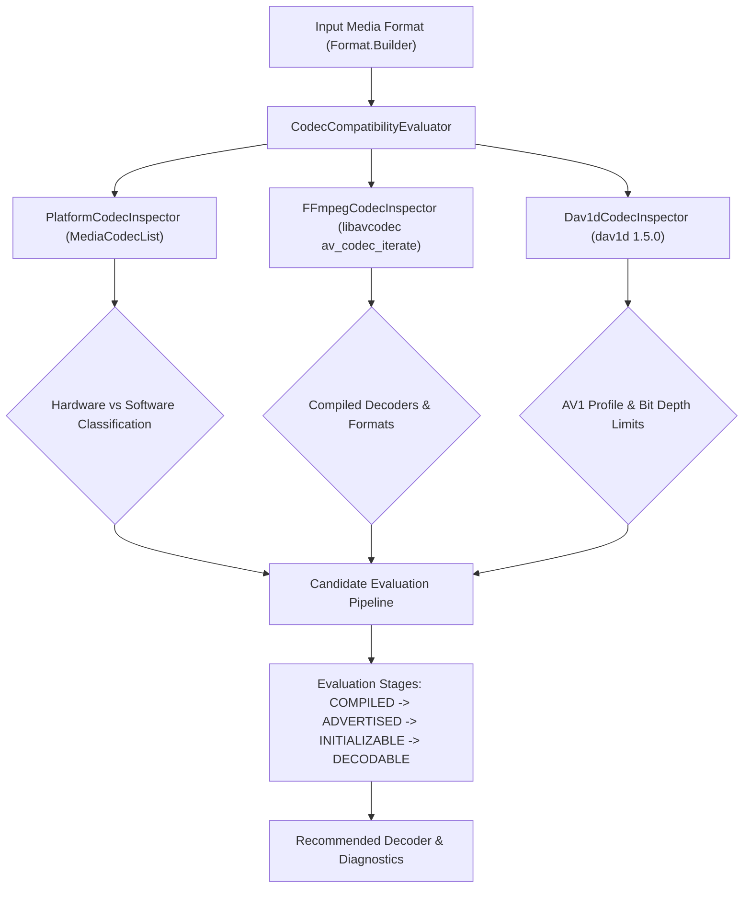

# NosvedMedia Codec Capability and Compatibility Report

## Executive Summary

Phase 6 implements a verified, non-speculative codec capability and compatibility evaluation architecture across **NosvedMedia** and **Nosved Player Lite**. Rather than hardcoding static assumptions about device decoders or software capabilities, the system uses runtime introspection across Android `MediaCodecList`, native FFmpeg `av_codec_iterate`, and dav1d capabilities.



---

## 1. Platform Codec Inspection Architecture

Android's `MediaCodecList` exposes all codecs registered with Stagefright/Codecs2. However, returning a codec name from Android does not guarantee hardware acceleration.

### 1.1 Hardware vs Software Classification

Platform codecs are classified into Hardware Accelerated vs Software according to strict rules:

1. **Android API 29+ (Android Q and later):**
   - Query `MediaCodecInfo.isHardwareAccelerated` directly.
   - Record `isSoftwareOnly` and `isVendor` flags.
2. **Android API 26-28 (Android O and P):**
   - Heuristic prefix evaluation:
     - **Software:** Names starting with `OMX.google.`, `c2.android.`, `OMX.ffmpeg.`, or containing `.sw.` or `software`.
     - **Hardware:** Names starting with vendor prefixes such as `OMX.qcom.`, `OMX.Exynos.`, `OMX.MTK.`, `OMX.sec.`, `OMX.Nvidia.`, `c2.qti.`, `c2.exynos.`, `c2.mtk.`.
     - Codecs not matching a known hardware vendor prefix are classified as software fallback.

### 1.2 Collected Platform Capabilities

For each supported MIME type, `PlatformCodecInspector` extracts:
- Supported profile levels mapped to human-readable names (e.g. AVC High, HEVC Main 10, VP9 Profile 2, AV1 Main 10).
- Resolution boundaries (`minWidth`, `maxWidth`, `minHeight`, `maxHeight`, `widthAlignment`, `heightAlignment`).
- Frame rate boundaries (`minFrameRate`, `maxFrameRate`).
- Color formats (including `COLOR_Format32bitABGR2101010` and `COLOR_FormatYUV420Flexible`).
- Supported bit depths (8-bit vs 10-bit verified via profile levels and color formats).
- HDR features (`HEVCProfileMain10HDR10`, `VP9Profile2HDR`, `AV1ProfileMain10HDR10`).
- DRM secure playback (`FEATURE_SecurePlayback`).
- Tunneled playback (`FEATURE_TunneledPlayback`).
- Performance points (API 29+ `supportedPerformancePoints`).

---

## 2. Native FFmpeg Capabilities (Runtime Introspection)

Static tables of supported codecs have been removed. `CodecInspector` in `native-codecs` iterates through all registered decoders at runtime using `av_codec_iterate()` and queries `avcodec_find_decoder()`.

### 2.1 Verified Compiled Video Decoders

| MIME Type | FFmpeg Decoder | Profiles Verified | Bit Depths | Pixel Formats |
|:---|:---|:---|:---|:---|
| `video/avc` | `h264` | Baseline, Main, High, High 10 | 8, 9, 10 | YUV420P, YUV422P, YUV444P, NV12 |
| `video/hevc` | `hevc` | Main, Main 10 | 8, 10 | YUV420P, YUV420P10LE, NV12 |
| `video/x-vnd.on2.vp9` | `vp9` | Profile 0, Profile 2 | 8, 10 | YUV420P, YUV420P10LE |
| `video/x-vnd.on2.vp8` | `vp8` | Version 0, 1, 2, 3 | 8 | YUV420P |
| `video/mp4v-es` | `mpeg4` | Simple, Advanced Simple | 8 | YUV420P |
| `video/mpeg2` | `mpeg2video` | Simple, Main | 8 | YUV420P, YUV422P |
| `video/wvc1` | `vc1` | Simple, Main, Advanced | 8 | YUV420P |

### 2.2 Verified Compiled Audio Decoders

| MIME Type | FFmpeg Decoder | Sample Formats | Channels Supported |
|:---|:---|:---|:---|
| `audio/mp4a-latm` | `aac` | Float planar (`fltp`) | Mono, Stereo, 5.1, 7.1 |
| `audio/ac3` | `ac3` | Float planar (`fltp`), S16 | Mono, Stereo, 5.1 |
| `audio/eac3`, `audio/eac3-joc` | `eac3` | Float planar (`fltp`) | Mono, Stereo, 5.1, 7.1 |
| `audio/true-hd`, `audio/mlp` | `truehd` | S32 planar (`s32p`) | Mono, Stereo, 5.1, 7.1 |
| `audio/vnd.dts`, `audio/vnd.dts.hd` | `dca` | Float planar (`fltp`), S16 | Mono, Stereo, 5.1, 7.1 |
| `audio/flac`, `audio/x-flac` | `flac` | S16, S32 planar (`s32p`) | Mono, Stereo, 5.1, 7.1 |
| `audio/opus` | `opus` | Float planar (`fltp`) | Mono, Stereo, 5.1, 7.1 |
| `audio/vorbis` | `vorbis` | Float planar (`fltp`) | Mono, Stereo, 5.1 |
| `audio/alac` | `alac` | S16 planar, S32 planar | Mono, Stereo, 5.1 |
| `audio/mpeg`, `audio/mp3` | `mp3` | Float planar (`fltp`), S16 | Mono, Stereo |
| `audio/x-ms-wma` | `wmav2` | Float planar (`fltp`) | Mono, Stereo |

---

## 3. dav1d AV1 Decoder Capabilities

dav1d 1.5.0 provides AV1 decoding for NosvedMedia.

- **Engine:** `dav1d 1.5.0`
- **Supported Profiles:**
  - Main (Profile 0): 8-bit & 10-bit 4:2:0
  - High (Profile 1): 8-bit & 10-bit 4:4:4
  - Professional (Profile 2): 8, 10, 12-bit 4:2:2
- **Pixel Layouts:** `I400` (Monochrome), `I420` (4:2:0 planar), `I422` (4:2:2 planar), `I444` (4:4:4 planar).
- **Bit Depths:** 8-bit, 10-bit.
- **Max Resolution:** Software decoding capped at 4096x2304 (4K) to preserve real-time frame rates.
- **Multi-threading:** Native tile and frame multi-threading configured according to device core count (`AdaptiveThreadingPolicy`).
- **Film Grain:** Hardware-accelerated SIMD film grain synthesis enabled.

---

## 4. Compatibility Evaluation Engine

`CodecCompatibilityEvaluator` determines stream compatibility based on full stream configuration, rather than MIME type alone.

### 4.1 Evaluation Lifecycle Stages

```
   [ COMPILED ]
        |
   [ ADVERTISED ]
        |
 [ INITIALIZABLE ]
        |
   [ DECODABLE ]
```

1. **COMPILED:** The binary decoder exists in the build (platform MediaCodec, libavcodec, or dav1d).
2. **ADVERTISED:** The decoder advertises support for the stream's MIME type and profile.
3. **INITIALIZABLE:** Decoder extradata and parameters can be successfully allocated without memory errors.
4. **DECODABLE:** Stream configuration (resolution, framerate, DRM crypto, bit depth) falls strictly within decoder limits.

### 4.2 Stream Constraints Evaluated

- **DRM Protection:** Software decoders reject DRM streams (`cryptoType != CRYPTO_TYPE_NONE`) with explicit error messages. Platform decoders require `FEATURE_SecurePlayback`.
- **Resolution Limit:** Software decoders enforce a 4096x2304 upper bound to avoid device OOM and pipeline starvation.
- **Bit Depth:** 10-bit HDR streams (identified via `ColorInfo` transfer ST2084 / HLG or codec string `hev1.2`, `vp09.02`, `av01.0.10`) require verified 10-bit support in the decoder candidate.
- **Profile Matching:** Mobile hardware decoders that do not support H.264 High 10 (Hi10P) automatically trigger software fallback to FFmpeg `h264`.

---

## 5. Player Lite Diagnostics UI

`DeviceStatsOverlay` displays real-time playback telemetry, strictly distinguishing between Advertised, Initialized, and Actively Decoding states:

- **Requested Mode:** Shows the active user selection (`Auto (HW+)`, `Hardware Only (HW)`, `Software Only (SW)`).
- **Active Video Decoder:** Exact engine name (e.g. `c2.qti.hevc.decoder` or `NosvedMedia FFmpeg Video`).
- **Decoder State:** Real-time state (`Advertised`, `Initialized`, `Actively Decoding`, `Fallback Pending`).
- **Technology:** Pipeline details (e.g. `dav1d 1.5.0 SIMD AV1 Native` or `FFmpeg 7.1 Native Multi-threaded`).
- **Codec & Profile:** Full codec name and detected profile (e.g. `HEVC / H.265 Main 10 (video/hevc)`).
- **Resolution & Framerate:** Real-time decoded resolution and measured display FPS.
- **Bit Depth & Pixel Format:** Bit depth (`8-bit`, `10-bit`) and format (`YUV420P10LE (BT.2020 PQ)`).
- **Fallback Reason:** If fallback occurred, displays the exact diagnostic explanation (e.g. `HW unsupported: 10-bit profile`).
- **Decoder Performance:** Real-time average decode latency in milliseconds and dropped frame count.

---

## 6. Unverified and Non-Advertised Capabilities

To avoid misleading claims:
- **Dolby Vision Profile 7 / Dual-Track:** Marked as unverified via software path; requires hardware platform decoder support.
- **8K Video via Software:** Software decoding of 8K (7680x4320) is deliberately rejected due to CPU thermal and throughput limits.
- **DRM Playback via Software:** Explicitly rejected; custom software decoders do not have access to hardware-protected Widevine L1 keystores.

